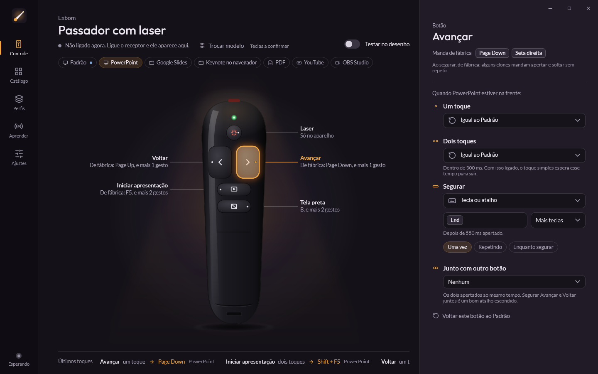

# Passador

Programa de Windows para passadores de slide. Ele reconhece o passador ligado, mostra o desenho do modelo e deixa
escolher o que cada botão faz: tecla, atalho, sequência, texto, abrir um programa, clique. Cada botão pode ter uma
ação para um toque, outra para dois toques e outra para segurar, e tudo muda sozinho conforme o programa que está na
frente (PowerPoint, Google Slides, Keynote no navegador, PDF, YouTube, OBS). Só os botões do passador mudam: o teclado
do computador fica igual.



Pedido 277 do Livro de Pedidos. A técnica (Raw Input, gancho WH_KEYBOARD, gestos, catálogo) está em
[docs/TECNICA.md](docs/TECNICA.md).

## Peças

| Pasta | O que é |
|---|---|
| `src/Passador.Core` | Catálogo, teclas, ações, perfis, gestos, configuração (sem Windows: testável) |
| `src/Passador.Motor` | Raw Input, a pergunta do gancho, SendInput, passador simulado |
| `native/gancho` | `passador_gancho.dll`, o gancho WH_KEYBOARD em C (3 KB), compilado com o MSVC no build |
| `src/Passador.App` | A tela (WPF), bandeja, vigia, atualização (Velopack), capturas e a prova do motor |
| `catalogo` | `modelos.json` e os desenhos SVG (gerados por `tools/desenhos.py`) |
| `tests/Passador.Testes` | Testes do Core: teclas, gestos, perfis, catálogo |

## Rodar e testar

```powershell
dotnet build src\Passador.App                       # compila (o gancho nativo junto)
dotnet test tests\Passador.Testes                   # testes
$env:PASSADOR_DADOS = "E:\Cache\build\Passador\demo"  # dados de teste, longe da configuração real
Passador.exe --capturar <pasta>                     # capturas das telas, sem aparecer na tela
Passador.exe --prova --agora                        # prova do motor com passador simulado (mexe na tela por ~10 s)
```

Os dados ficam em `%LOCALAPPDATA%\Passador.Dados` (`config.json`, `passador.log`, a cópia do gancho). Nunca ficam na
pasta do Velopack, que o desinstalador apaga inteira.

## Lançar uma versão

1. Escrever `docs/novidades/X.Y.Z.md` e subir a `<Version>` no `Directory.Build.props`.
2. `git tag vX.Y.Z` e `git push origin vX.Y.Z`.
3. O Actions roda `build.ps1 -Publicar` (gancho, testes, Velopack com delta) e publica o Release.
4. O `espelho.yml` leva o Release para `clarify-atualizacoes.caiorossi.com/passador`, e o Passador instalado se atualiza
   sozinho: procura ao abrir e a cada 4 horas, e troca de versão ao reiniciar.

O vigia reabre o Passador se ele cair. Se uma versão nova cair três vezes antes de ficar 3 minutos aberta, ele volta
para a anterior.

© 2026 Caio Rossi. Todos os direitos reservados.
