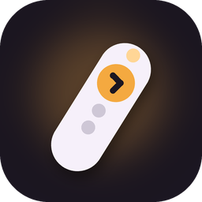
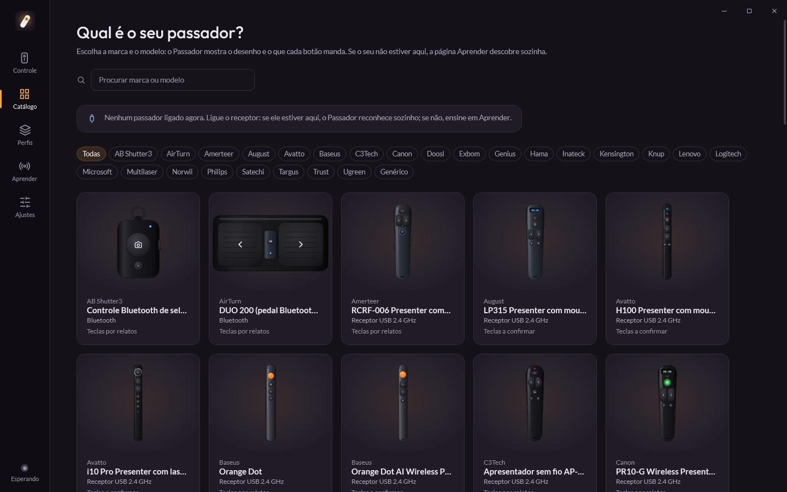
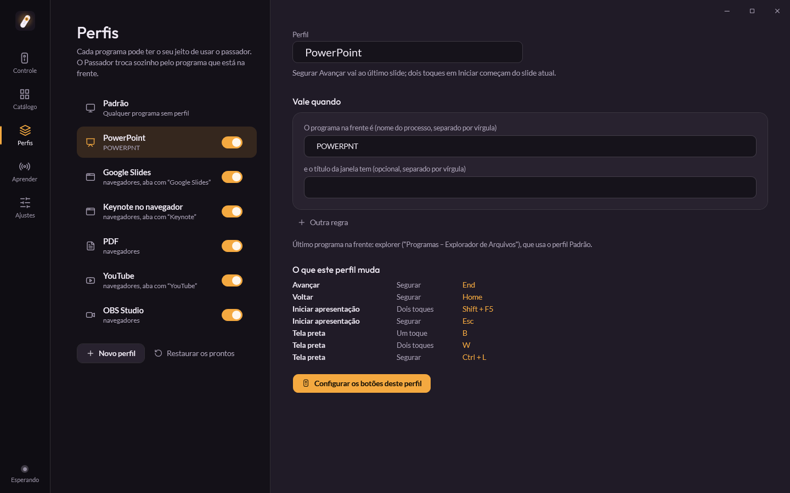
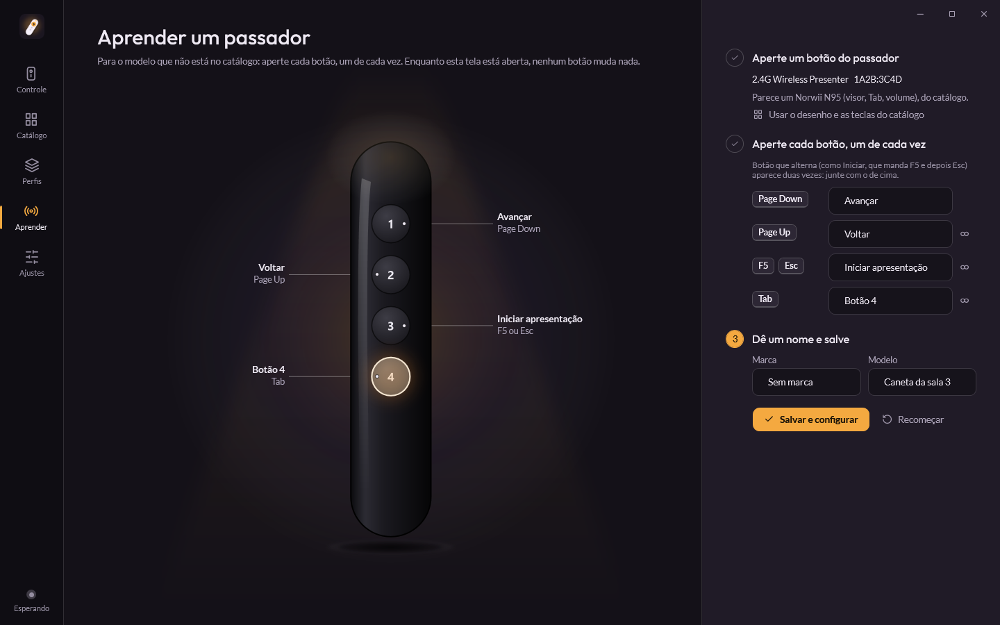
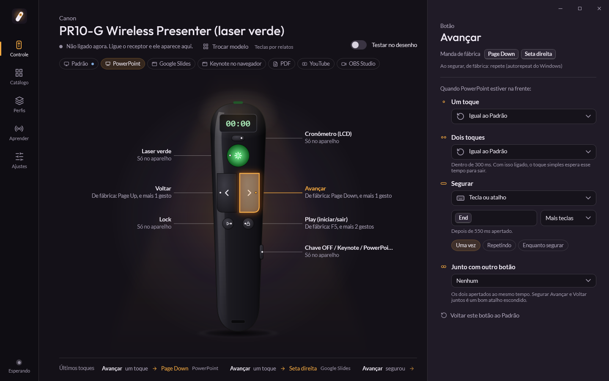
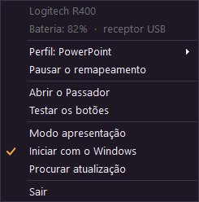

<p align="center"></p>

<h1 align="center">Passador</h1>

<p align="center">
Programa gratuito de Windows para passadores de slide.<br>
Free Windows app for presentation clickers.<br><br>
<a href="https://passador.caiorossi.com">passador.caiorossi.com</a> ·
<a href="https://github.com/caioross/passador/releases/latest">Baixar / Download</a> ·
<a href="CONTRIBUTING.md">Contribuir / Contribute</a>
</p>


**Português** · [English](#english)

O Passador reconhece o passador de slides ligado no computador, mostra o desenho do modelo e deixa escolher o que cada
botão faz: uma tecla, um atalho, uma sequência, um texto, abrir um programa, um clique. Cada botão pode ter uma ação
para um toque, outra para dois toques e outra para segurar. As ações mudam sozinhas conforme o programa da frente
(PowerPoint, Google Slides, Keynote no navegador, PDF, YouTube, OBS). Só os botões do passador mudam: o teclado do
computador continua igual.

- **60 modelos no catálogo**, cada um com desenho próprio: Logitech, Kensington, Targus, Canon, Norwii, Doosl, Baseus,
  Multilaser, Knup, Exbom, Microsoft, Lenovo, anéis de dedo, controles de TikTok e genéricos. Modelo fora da lista? O
  modo **Aprender** ensina os botões em segundos.
- **Gestos:** toque, dois toques, segurar (uma vez, repetindo ou enquanto segura) e dois botões juntos.
- **Perfis por programa**, prontos para PowerPoint, Google Slides, Keynote, PDF, YouTube e OBS, e os seus.
- **Bandeja:** perfil em uso com troca rápida, pausar, aparelho ligado e bateria (quando o aparelho informa), testar,
  iniciar com o Windows, procurar atualização e modo apresentação.
- **Sem driver** e sem administrador. Atualiza sozinho.

| | |
|---|---|
|  |  |
|  |  |

<p align="center"></p>

### Instalar

Baixe o `Passador-win-Setup.exe` do [Release mais recente](https://github.com/caioross/passador/releases/latest) e
abra. Ele instala sem pedir administrador, abre com o Windows e fica na bandeja. Para desinstalar: Configurações >
Aplicativos. Os dados ficam em `%LOCALAPPDATA%\Passador.Dados`.

Quem usava o **Batuta** (o nome antigo, até a 0.1.2): instale o Passador. Ele copia a configuração do Batuta, fecha o
Batuta e tira o Batuta do início do Windows. Depois é só desinstalar o Batuta em Configurações > Aplicativos.

### Perguntas rápidas

- **Precisa de driver?** Não. O passador é um teclado para o Windows; o Passador lê o aparelho pelo Raw Input e usa um
  gancho de teclado pequeno (uma DLL de 3 KB, em `native/gancho`) para trocar só as teclas que vêm dele.
- **E o laser?** O laser é luz, não chega ao computador. Ele continua funcionando igual.
- **Bluetooth?** Funciona: para o Windows, um passador Bluetooth também é um teclado. A bateria aparece no menu quando o
  aparelho informa ao Windows.
- **Mac ou Linux?** Ainda não. O motor usa APIs do Windows. Quem quiser portar, é bem-vindo.

### Desenvolver

| Pasta | O que é |
|---|---|
| `src/Passador.Core` | Catálogo, teclas, ações, perfis, gestos, configuração (sem Windows, testável) |
| `src/Passador.Motor` | Raw Input, a pergunta do gancho, SendInput, bateria, passador simulado |
| `native/gancho` | `passador_gancho.dll`, o gancho WH_KEYBOARD em C, compilado com o MSVC no build |
| `src/Passador.App` | A tela (WPF), bandeja, vigia, atualização (Velopack), capturas e a prova do motor |
| `catalogo` | `modelos.json` e os desenhos SVG (gerados por `tools/desenhos.py`) |
| `tests/Passador.Testes` | Testes do Core e do catálogo |

```powershell
dotnet build src\Passador.App                  # compila (o gancho nativo junto; precisa do Visual Studio Build Tools com C++)
dotnet test tests\Passador.Testes              # testes
python tools\confere_catalogo.py               # confere o catálogo e os desenhos
$env:PASSADOR_DADOS = "$env:TEMP\passador-demo" # dados de teste, longe da configuração real
Passador.exe --capturar <pasta>                # capturas das telas, sem aparecer na tela
Passador.exe --aparelhos                       # lista os teclados ligados (VID, PID, nome, bateria)
Passador.exe --prova --agora                   # prova do motor com passador simulado (mexe na tela por ~10 s)
```

A técnica (Raw Input, gancho WH_KEYBOARD, gestos, catálogo) está em [docs/TECNICA.md](docs/TECNICA.md). Para lançar
uma versão: notas em `docs/novidades/X.Y.Z.md`, `<Version>` no `Directory.Build.props` e a tag `vX.Y.Z`; o GitHub
Actions roda `build.ps1 -Publicar` e publica o Release.

Licença MIT. As marcas citadas pertencem aos donos; os desenhos são nossos e genéricos, sem logo.

---

<a id="english"></a>

## English

Passador ("slide clicker" in Portuguese) recognizes the presentation clicker plugged into your PC, shows a drawing of
that model and lets you choose what each button does: a key, a shortcut, a sequence, typed text, opening a program, a
mouse click. Each button can have one action for a tap, another for a double tap and another for a hold. Actions
switch automatically with the app in front (PowerPoint, Google Slides, Keynote on the web, PDF, YouTube, OBS). Only
the clicker's buttons change; your real keyboard stays the same.

- **60 models in the catalog**, each with its own drawing. Not on the list? **Learn** mode maps the buttons in seconds.
- **Gestures:** tap, double tap, hold (once, repeating or while held) and two buttons together.
- **Per-app profiles**, ready for PowerPoint, Google Slides, Keynote, PDF, YouTube and OBS, plus your own.
- **Tray menu:** active profile with quick switch, pause, connected device and battery (when the device reports it),
  test, start with Windows, check for updates and presentation mode.
- **No driver** and no admin rights. Updates itself.

**Install:** download `Passador-win-Setup.exe` from the [latest release](https://github.com/caioross/passador/releases/latest).
The interface is in Portuguese for now; translations are welcome.

**FAQ.** *Driver?* No: a clicker is a keyboard to Windows; Passador reads it through Raw Input and a tiny keyboard
hook DLL. *Laser?* It is just light and keeps working. *Bluetooth?* Yes. *Mac or Linux?* Not yet.

**Contributing:** the easiest way to help is adding a clicker to the catalog. See [CONTRIBUTING.md](CONTRIBUTING.md)
(the JSON entry and the SVG drawing). Please follow the [Code of Conduct](CODE_OF_CONDUCT.md).

MIT License. Brand names belong to their owners; the drawings are our own generic artwork, with no logos.
